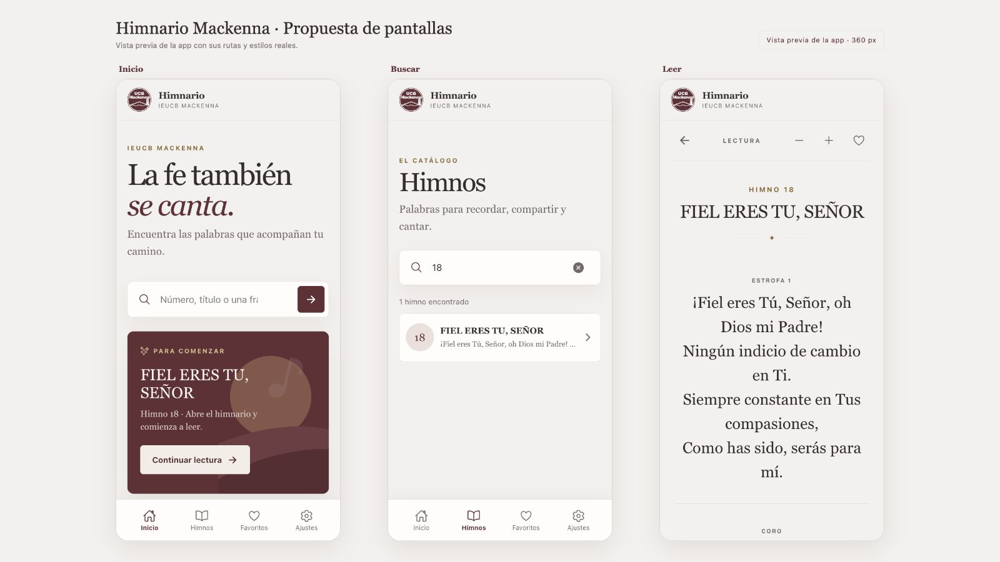

# Diseño de la aplicación

La interfaz se plantea en español y prioriza localizar un himno por número o texto y leer su contenido con comodidad. Deben conservarse los números originales, las variantes A/B, la separación entre estrofas y coros, y la estructura de líneas del catálogo.

Las rutas implementadas son Inicio (`/`), catálogo (`/himnos`), lectura (`/himno/:id`), Favoritos (`/favoritos`) y Ajustes (`/ajustes`). Desde Inicio o el catálogo se busca por número o texto; la lectura ofrece navegación entre himnos y control de favoritos. La navegación y los estados comunican resultados vacíos y rutas de lectura inválidas.

El tema visual usa tonos vino, crema y papel, con una opción oscura; la pantalla de ajustes permite elegir tema, tamaño de letra y estilo tipográfico de lectura. Las dos familias tipográficas (“Sistema”, sin remates, y “Clásica”, con remates) usan fuentes disponibles en cada dispositivo y se guardan en preferencias locales; no se descargan fuentes. La barra de navegación inferior adapta sus áreas seguras al dispositivo. La revisión visual en navegador cubrió tres pantallas en viewport móvil de 360 px; las pruebas en dispositivos nativos siguen pendientes.

Los controles deben tener nombres accesibles, foco visible y áreas táctiles amplias. Mantener contraste suficiente y permitir lectura con texto grande. Evitar añadir autores, categorías o metadatos que no estén respaldados por la fuente.

## Pantallas de referencia

La revisión en navegador cubrió búsqueda por consulta completa y número, variantes A/B, estado vacío, lectura con navegación anterior/siguiente, favoritos y persistencia de ajustes al recargar. Consulta la [muestra visual de pantallas](../public/pantallas.html) y la captura de referencia:

